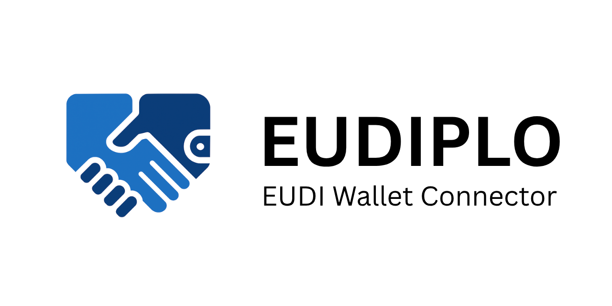
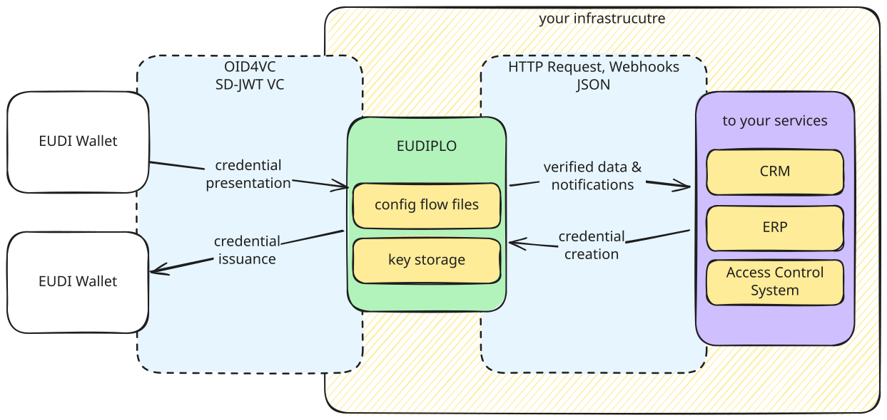

[](https://github.com/EUDIPLO/eudiplo/actions)
[](https://github.com/EUDIPLO/eudiplo/releases)

[](https://scorecard.dev/viewer/?uri=github.com/EUDIPLO/eudiplo)
[](https://discord.gg/58ys8XfXDu)

# Your Diplomatic Layer for EUDI Wallet Integration

EUDIPLO is open-source middleware for the EU Digital Identity Wallet that runs
on your own servers. Your backend makes one API call; EUDIPLO handles the
wallet protocols, keys and credential formats to verify and issue credentials.

EUDIPLO is an [LF Decentralized Trust](https://www.lfdecentralizedtrust.org/)
project, licensed under Apache 2.0. It was previously hosted by the
OpenWallet Foundation.



## Why EUDIPLO

- **Self-hosted, not SaaS.** Run it on-premises, in your private cloud or in
  any EU data center. Wallet responses are decrypted on your server and go
  straight to your backend.
- **Your keys.** Signing keys can live in an HSM (PKCS#11), AWS KMS or
  HashiCorp Vault.
- **One HTTP API for any stack.** Issue credentials, request presentations, or
  request a presentation during issuance, with webhooks back to your
  backend. A web client lets your team manage tenants and configuration in the
  browser.
- **Standards-based and conformance tested.** OpenID4VCI 1.0, OpenID4VP 1.0,
  DCQL, SD-JWT VC, ISO 18013-5 mdoc, ISO 18013-7 Annex C, the Digital
  Credentials API and Token Status List. Every change runs against the OpenID
  Foundation conformance suite.
- **Multi-tenant.** Serve several organizations or customers from one
  deployment.

## Get started

```bash
npx @eudiplo/cli demo
```

This starts a local demo with the API and web client. See the
[Quick Start](https://docs.eudiplo.dev/cookbooks/foundation) for the
standalone CLI and other install options.

## Repositories

| Repository                                          | Description                                                       |
| --------------------------------------------------- | ----------------------------------------------------------------- |
| [eudiplo](https://github.com/EUDIPLO/eudiplo)       | Backend, web client, CLI, SDKs and documentation                  |
| [governance](https://github.com/EUDIPLO/governance) | Teams and project governance                                      |
| [.github](https://github.com/EUDIPLO/.github)       | This profile and the default community files for all repositories |

## Links

- 🌐 Website: [eudiplo.dev](https://eudiplo.dev)
- 📚 Documentation: [docs.eudiplo.dev](https://docs.eudiplo.dev)
- 🧪 [Wallet compatibility](https://docs.eudiplo.dev/reference/wallet-compatibility)
- 📺 [Webinar recording (September 2025)](https://www.youtube.com/watch?v=GQlvHK-EFlU)
- 💬 [Discord](https://discord.gg/58ys8XfXDu) for questions and help
- 🤝 Bi-weekly community call on Thursdays:
  [join via Zoom](https://zoom-lfx.platform.linuxfoundation.org/meeting/94494306854?password=0d272140-5b2b-4bd4-a8fe-0b70efe1aa86)

## Contributing

We welcome contributions from wallet developers, institutions and anyone
interested in the EUDI Wallet ecosystem. See the
[contribution guidelines](https://github.com/EUDIPLO/.github/blob/main/CONTRIBUTING.md)
for the rules that apply to every repository, and the
[eudiplo contributing guide](https://github.com/EUDIPLO/eudiplo/blob/main/CONTRIBUTING.MD)
for setting up the service locally.

Report security issues privately as described in the
[security policy](https://github.com/EUDIPLO/.github/blob/main/SECURITY.md).
See [GOVERNANCE.md](https://github.com/EUDIPLO/.github/blob/main/GOVERNANCE.md)
for how decisions are made and who maintains the project, and the
[technical charter](https://github.com/EUDIPLO/.github/blob/main/CHARTER.pdf)
it summarizes.

EUDIPLO follows the
[LF Decentralized Trust Code of Conduct](https://lf-decentralized-trust.github.io/governance/governing-documents/code-of-conduct/).
